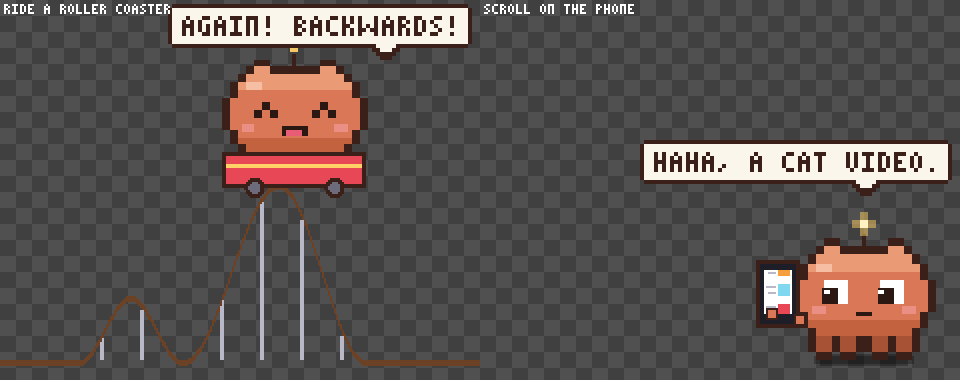
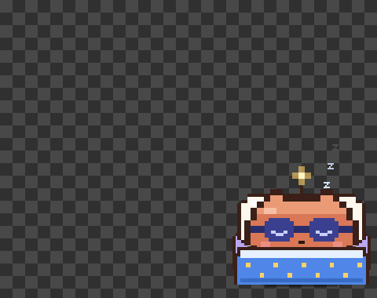

# Fable Buddy

A tiny pixel-art desktop companion that lives in the corner of your Windows screen.

  

## Run it

Download `FableBuddy.exe` from the [latest release](../../releases/latest) and double-click it. That's all — no installer.

- It sits on top of your taskbar in the bottom-right corner, always on top.
- It registers itself to **start with Windows** on first run (toggle it in the right-click menu).
- Windows SmartScreen may warn because the exe is unsigned: *More info → Run anyway*.
- Keep the exe somewhere permanent (e.g. Documents); if you move it, run it once from the new place.

## What it does

| Do this | And it... |
| --- | --- |
| Move your mouse | follows the cursor with its eyes |
| Click it | gets petted: hearts, a happy face, a little hop |
| Drag and fling it | flies with real physics, bounces off the screen edges, then walks home |
| Leave the PC for 2 minutes | tucks itself in with a blanket, pillows and an eye mask and snores small z's; wakes when you return |
| Open a fullscreen game or video | hides until you leave fullscreen |
| Wait | does a random one of **53 activities** on its own every few seconds to a minute: rides a roller coaster, scrolls on its phone, drinks coffee, plays guitar, goes fishing, skateboards, paints, toasts marshmallows, takes a bubble bath, gets the hiccups, pets a kitty that wanders by... |
| Want more or fewer | right-click → *Random activities* → Often / Normal / Chill (remembered) |
| Want to see one now | right-click → *Do something fun!*, or pick any of them from *Activities* |
| Wait some more | hops, strolls, and drops one of 70+ lines (reminders, fun facts, day-of-week and time-aware comments); tells you when a new hour starts |
| Have 2+ screens | roams all of them: throw it from one screen to another, and it leaps back home in an arc. Now and then it visits your other screens by itself |
| Plug in or remove a screen | notices, tells you, and moves to a screen that still exists |
| Right-click it | Do something fun! · Activities · Say something · Jump! · switch corner · **Live on screen** (pick any screen) · Start with Windows · Quit. The menu opens above it, never on top of it |

## How it's built

One dependency-free Go program (no cgo, no libraries):

- `buddy.go` — simulation (physics, moods, particles) and a software renderer with its own pixel font
- `activities.go` — the 53 activities: props, poses, particles and lines for each
- `main_windows.go` — Win32 shell: a per-pixel-alpha layered window, so there is no window frame and clicks pass through the transparent parts
- `preview_other.go` — renders test frames to PNG on non-Windows machines (`go run . <dir> sheet` draws every activity on one sheet)
- `buddy_test.go` — tests for multi-screen physics (side-by-side, stacked, gaps, unplugging) and that every phrase can be drawn; run `go test`

Build it yourself: install [Go](https://go.dev/dl), then double-click `build.bat`. It builds `FableBuddy.exe` and starts it.

To publish a new release, change the number in `VERSION` and push; GitHub Actions builds the exe and attaches it to a release.

Uninstall: right-click → untick *Start with Windows*, Quit, delete the exe.
