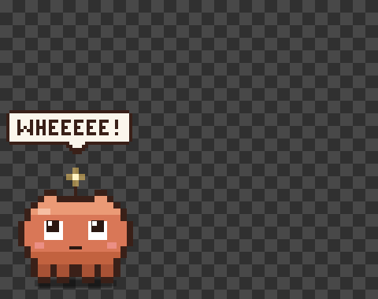
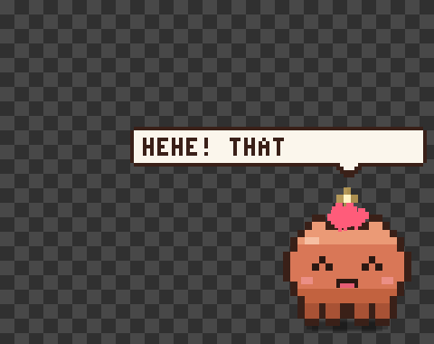

# Fable Buddy

A tiny pixel-art desktop companion that lives in the corner of your Windows screen.

 

## Run it

Download [`dist/FableBuddy.exe`](dist/FableBuddy.exe) and double-click it. That's all — no installer.

- It sits on top of your taskbar in the bottom-right corner, always on top.
- It registers itself to **start with Windows** on first run (toggle it in the right-click menu).
- Windows SmartScreen may warn because the exe is unsigned: *More info → Run anyway*.
- Keep the exe somewhere permanent (e.g. Documents); if you move it, run it once from the new place.

## What it does

| Do this | And it... |
| --- | --- |
| Move your mouse | follows the cursor with its eyes |
| Click it | gets petted: hearts, a happy face, a little hop |
| Drag and fling it | flies with real physics, bounces off the screen edges, then walks home |
| Leave the PC for 2 minutes | falls asleep and snores; wakes up when you return |
| Wait | hops, strolls, and drops the occasional reminder; tells you when a new hour starts |
| Right-click it | Say something · Jump! · switch corner · Start with Windows · Quit |

## How it's built

One dependency-free Go program (no cgo, no libraries):

- `buddy.go` — simulation (physics, moods, particles) and a software renderer with its own pixel font
- `main_windows.go` — Win32 shell: a per-pixel-alpha layered window, so there is no window frame and clicks pass through the transparent parts
- `preview_other.go` — renders test frames to PNG on non-Windows machines

Build it yourself:

```
GOOS=windows GOARCH=amd64 go build -trimpath -ldflags "-s -w -H windowsgui" -o dist/FableBuddy.exe .
```

Uninstall: right-click → untick *Start with Windows*, Quit, delete the exe.
